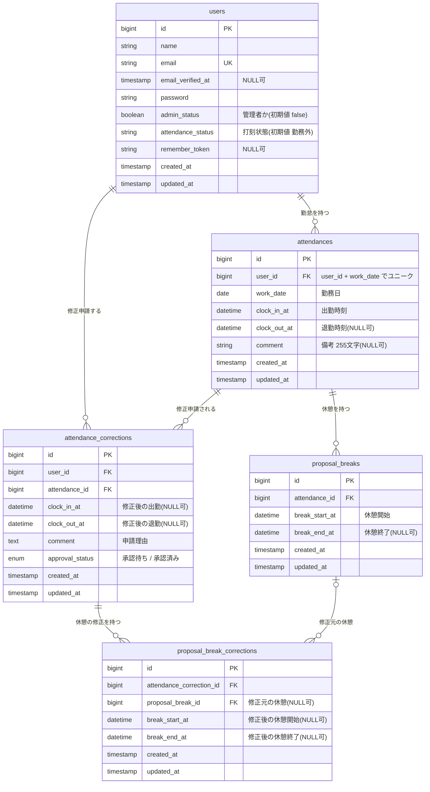

# 勤怠管理アプリ

勤怠管理アプリです。出勤・退勤の打刻、勤怠の修正申請、月次レポートの表示に加えて、外部のシステムやアプリから勤怠を操作できる REST API（Laravel Sanctum 認証）を備えています。

<!-- TODO: スクリーンショットを追加する（例）

-->

## 目次

- [主な機能](#主な機能)
- [使用技術](#使用技術)
- [環境構築](#環境構築)
- [テスト](#テスト)
- [API 仕様](#api-仕様)
- [テーブル設計](#テーブル設計)
- [工夫した点](#工夫した点)

## 主な機能

### 画面（Web）

- 出勤・退勤・休憩の打刻
- 勤怠一覧・勤怠詳細の確認
- 勤怠の修正申請（備考の入力が必須。承認待ちの間は、重ねて申請できない）
- 管理者による修正申請の承認
- 月次レポート（勤務時間・残業時間の月別推移、遅刻・早退・長時間労働の回数）
  - 直近 6 か月分を集計する
  - 退勤済みの勤怠だけを、合計・平均に含める

### API

- 勤怠の一覧取得・詳細取得（認証不要）
- 勤怠の新規登録（認証必須）
- 勤怠の更新・削除（認証必須。本人、管理者のみ）


## 使用技術

| 区分 | 内容 |
|---|---|
| 言語 | PHP |
| フレームワーク | Laravel |
| データベース | MySQL |
| 開発環境 | Docker（Laravel Sail） |
| API 認証 | Laravel Sanctum（トークン認証） |
| テスト | PHPUnit（Laravel の Feature テスト） |
| バージョン管理 | Git / GitHub |

<!-- TODO: PHP と Laravel のバージョンを記載する（例: PHP 8.3 / Laravel 10.x） -->

## 環境構築

```bash
# 1. リポジトリを取得する（フォルダ名を attendance-app にする）
git clone https://github.com/ryoga613/Attendance--apprication.git attendance-app
cd attendance-app

# 2. 環境変数ファイルを作る
cp .env.example .env

# 3. 依存パッケージをインストールする
docker run --rm \
  -u "$(id -u):$(id -g)" \
  -v "$(pwd):/var/www/html" \
  -w /var/www/html \
  laravelsail/php82-composer:latest \
  composer install --ignore-platform-reqs

# 4. コンテナを起動する
./vendor/bin/sail up -d

# 5. アプリケーションキーを作る
./vendor/bin/sail artisan key:generate

# 6. テーブルを作り、初期データを入れる（MySQLの起動に数十秒かかるので、失敗したら少し待って再実行）
./vendor/bin/sail artisan migrate --seed


起動後、ブラウザで http://localhost にアクセスしてください。
phpMyAdminは　http://localhost:8080 にアクセスしてください。

### テスト用アカウント

<!-- TODO: シーダーで作成されるアカウントを記載する -->

| 種別 | メールアドレス | パスワード |
|---|---|---|
| 一般ユーザー | user1@example.com | password |
| 一般ユーザー | user2@example.com | password |
| 管理者 | user3@example.com | password |

## テスト

```bash
./vendor/bin/sail artisan test
```

主に次のテストを書いています。

- API の認証・認可（未認証は 401、他人の勤怠の更新・削除は 403）
- API の登録・更新・削除と、入力値の検証（422）
- 月次レポートの集計（合計・平均・遅刻などの回数・他のユーザーのデータが混ざらないこと）

## API 仕様

ベース URL: `http://localhost/api`

### 認証

ログインしてトークンを取得し、以降のリクエストの `Authorization` ヘッダーに付けます。

```bash
# トークンの取得
curl -X POST http://localhost/api/login \
  -H "Accept: application/json" \
  -d "email=メールアドレス" -d "password=パスワード"

# レスポンス
# { "token": "1|abcdef..." }
```

> すべてのリクエストに `Accept: application/json` を付けてください。

### エンドポイント一覧

| メソッド | パス | 内容 | 認証 | 認可 |
|---|---|---|---|---|
| GET | `/api/v1/attendance-records` | 勤怠一覧を取得する | 不要 | 不要 |
| GET | `/api/v1/attendance-records/{id}` | 勤怠詳細を取得する | 不要 | 不要 |
| POST | `/api/v1/attendance-records` | 勤怠を新規登録する（出勤打刻） | 必須 | なし |
| PUT | `/api/v1/attendance-records/{id}` | 勤怠を更新する（退勤打刻など） | 必須 | 本人,管理者のみ |
| DELETE | `/api/v1/attendance-records/{id}` | 勤怠を削除する | 必須 | 本人,管理者のみ |


### 使用例

```bash
curl -X POST http://localhost/api/v1/attendance-records \
  -H "Authorization: Bearer 取得したトークン" \
  -H "Accept: application/json" \
  -d "work_date=2026-10-20" \
  -d "clock_in_at=2026-10-20 09:00:00"
```

## テーブル設計

### ER図



- `user_id` と `work_date` の組み合わせにユニーク制約があり、1 ユーザー 1 日 1 件です。


<!-- ## 工夫した点

- **退勤時刻を後から追加できる設計**：実際の打刻の流れ（出勤ボタン → 退勤ボタン）に合わせ、出勤時に勤怠を作成し、退勤時に更新する形にしました。
- **認可の分離**：Web 画面では管理者が勤怠を直接編集できますが、API は「本人のみ」とし、Policy の `before()` で管理者を素通りさせないようにしています。
- **エラーレスポンスの統一**：401・403・404 を API の仕様どおりの JSON で返すようにしています。
- **テストでの検証**：認可の境界（本人・他人・管理者）や、月次レポートの集計を、Factory で作ったデータで確認しています。 -->